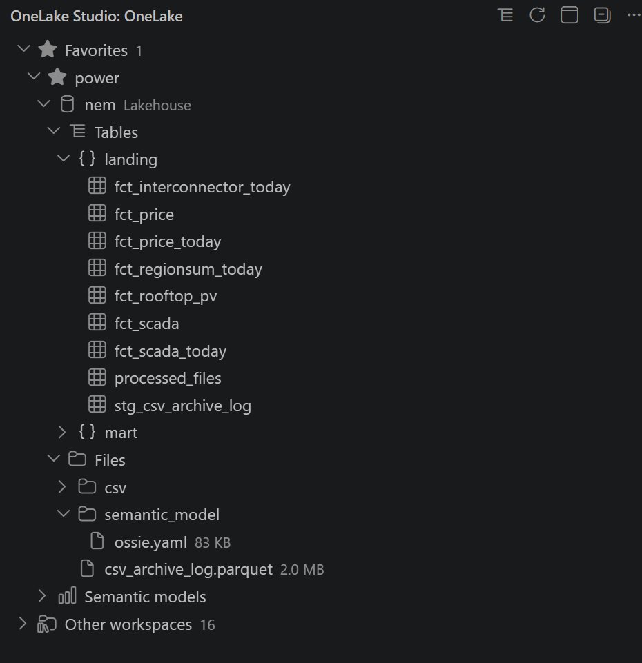

# OneLake Studio for VS Code

Browse and query your Microsoft Fabric data in VS Code, signed in with the Microsoft account
VS Code already uses.

Fabric is treated as one catalog: tables, files and semantic models (views over tables), each with
a unique name, queried with SQL. Read only, cache first, and it works offline.

## What you can do

- **Browse OneLake.** Workspaces, lakehouses, warehouses, SQL and mirrored databases, their tables
  and files, in one tree. Pin workspaces, or filter to one type, such as semantic models.
- **Query with SQL.** Every table has one name, `lakehouse.workspace.item.schema.table`, and every
  semantic model is `semanticmodel.workspace.model`. The type comes first because a lakehouse and
  a warehouse can share a name. Join across items and workspaces;
  `SHOW ALL TABLES` lists every one it knows about. Write it in a tab's SQL box; Ctrl+Enter runs
  the statement under the cursor, and the results show in that tab. Whatever you open gets a tab of its own.
- **Look at a table in a click.** Columns, row count, first rows, and Delta or Iceberg stats and
  history.
- **Open lakehouse files.** Parquet, CSV, JSON, Excel, DuckDB and SQLite, even inside a zip.
- **Explore a semantic model.** Its tables and relationships, and a drag-and-drop pivot as a table
  or a chart, with the SQL behind it.
- **Ask Claude Code or GitHub Copilot.** One command, and your assistant can list your data, read a
  model's measures and compute them.
- **Fast after the first look.** What you've opened is kept on your machine.
- **Works offline.** What you've read keeps working with no internet: browse it, query it, pivot it.

## Experimental

- **Publish to Fabric.** Turn a model's Explore into a Fabric app your colleagues open in a browser,
  showing the model's current data to those with access. A copy stays in your folder.
- **See your Fabric apps.** Each workspace lists its apps, their address and who can open them.

## Get started

1. Install **OneLake Studio** from Extensions (`Ctrl+Shift+X`), the
   [Marketplace](https://marketplace.visualstudio.com/items?itemName=djouallah.onelake-studio), or
   `code --install-extension djouallah.onelake-studio`.
2. Click the OneLake Studio icon in the activity bar and sign in.

Needs desktop VS Code 1.101+ on Windows x64, or macOS or Linux (x64 or arm64).

**Read only.** There are three exceptions, and each asks first. *Export to Fabric* publishes an app. *Create Semantic
Model* makes a Power BI semantic model of a model file. *Upload Files…* writes files from your computer into a lakehouse's `Files/`. Opening a semantic model keeps it on your machine only.

How it works: [the website](https://djouallah.github.io/onelake_studio/how-it-works.html). Commands,
settings and release notes: [the docs](https://djouallah.github.io/onelake_studio/docs/).

> A personal project, not a Microsoft product or supported by Microsoft. Results computed from a
> semantic model aren't guaranteed to match Power BI.
