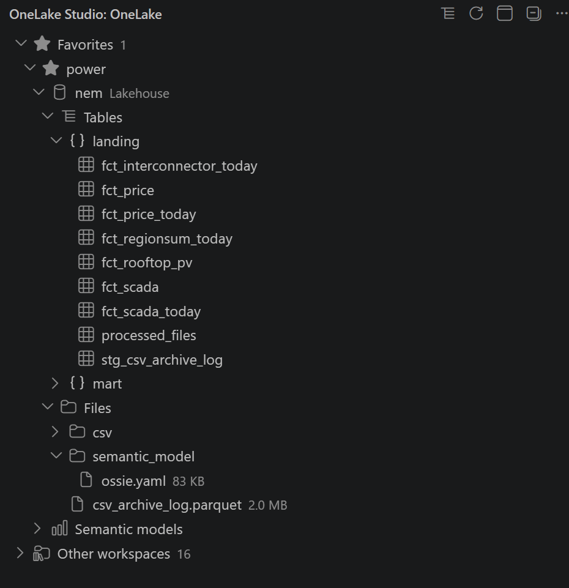

# OneLake Studio

A VS Code extension to browse Microsoft Fabric OneLake: workspaces, lakehouses, warehouses,
tables, files and Power BI semantic models, read only, signed in with the Microsoft account
VS Code already uses. Open it from the OneLake Studio icon in the activity bar, or run
**OneLake Studio: Open** from the command palette.

- Query tables and `Files/` with SQL, and save results as CSV.
- Open a semantic model to see its tables, measures and relationships, explore it as a pivot
  or chart, and query it with `AGG(measure)`.
- **Install Agent Skill** lets Claude Code or GitHub Copilot answer questions about your data.
- Everything is cached on this machine; nothing is ever written to Fabric or OneLake.

Commands, settings, how it works and release notes: [docs/](https://github.com/djouallah/onelake_studio/tree/main/docs).

> A personal learning project — not a Microsoft product or supported by Microsoft, and DAX compiled
> to SQL here is not guaranteed to match Power BI.
